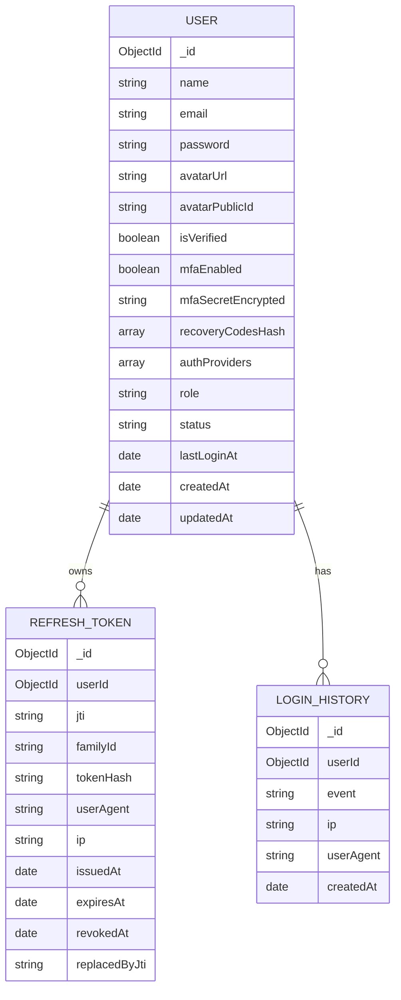
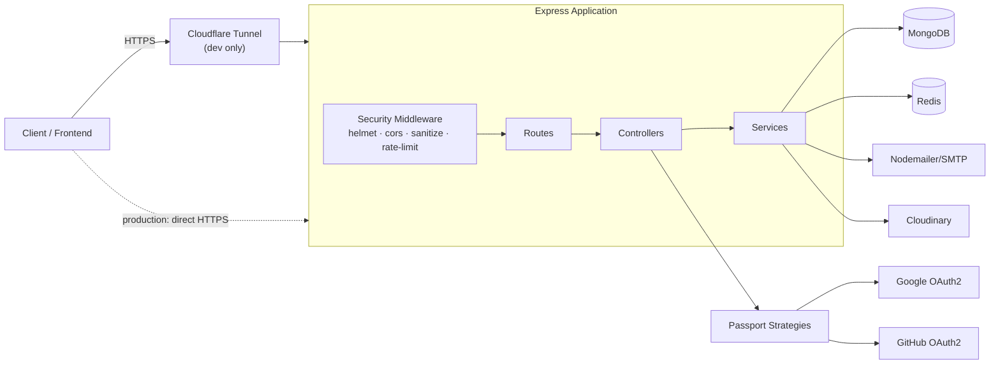
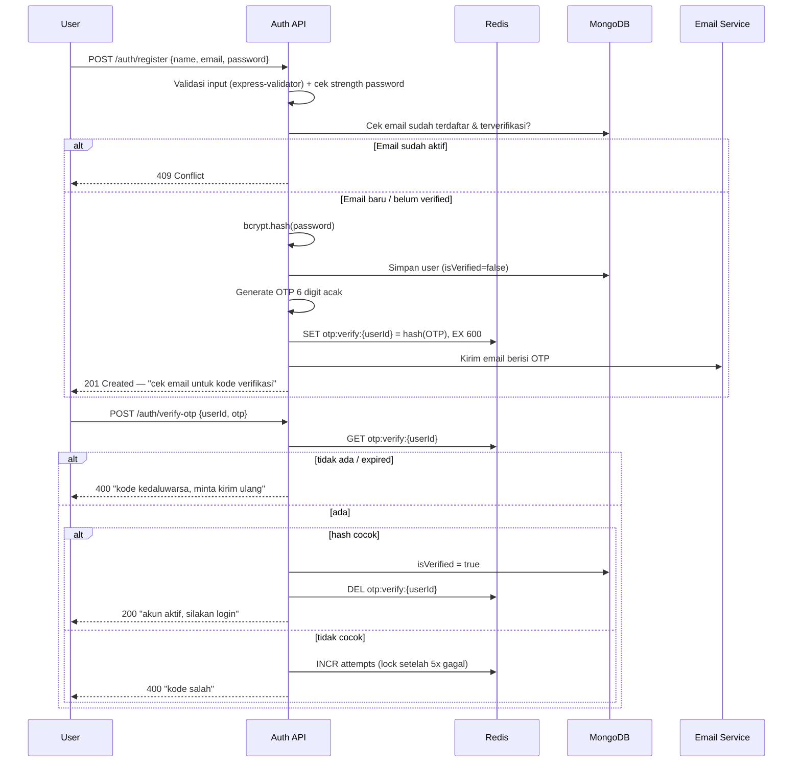
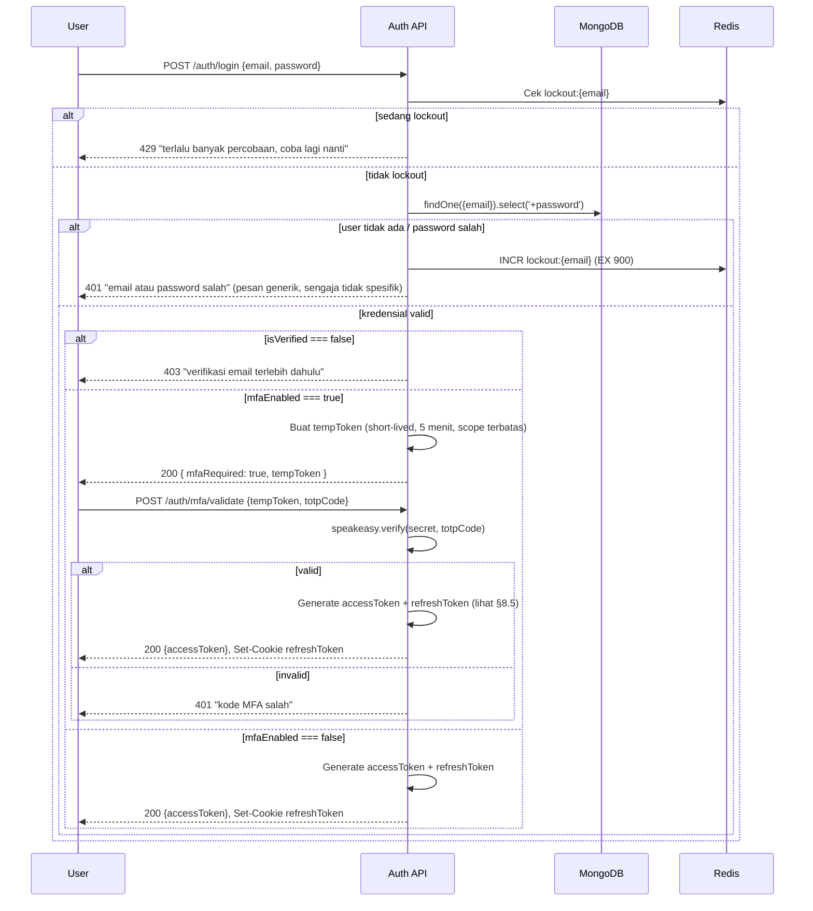
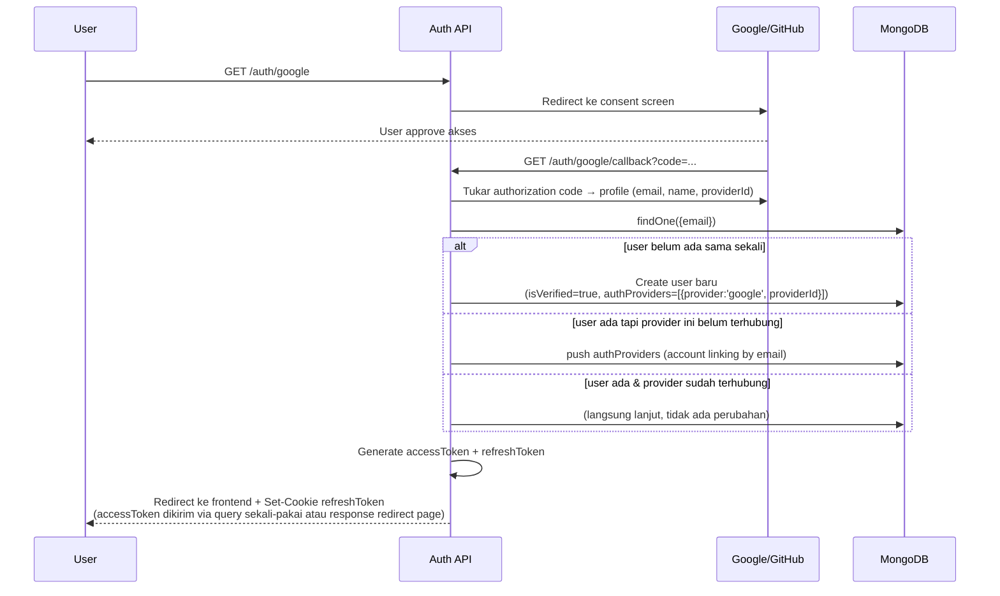
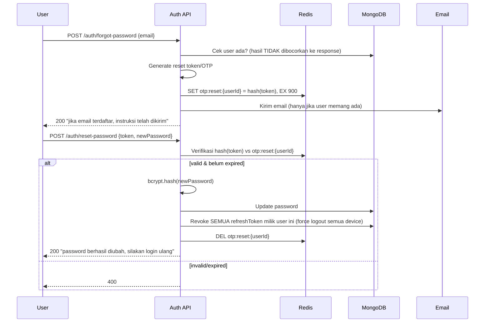
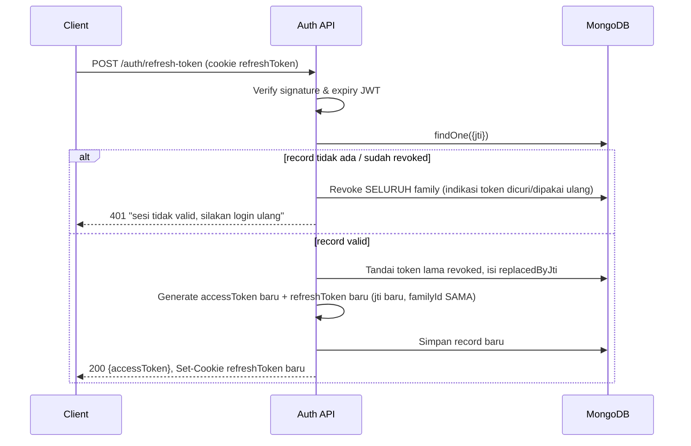
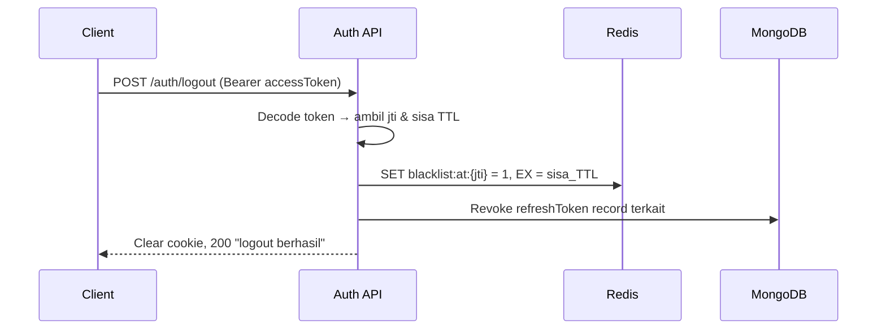
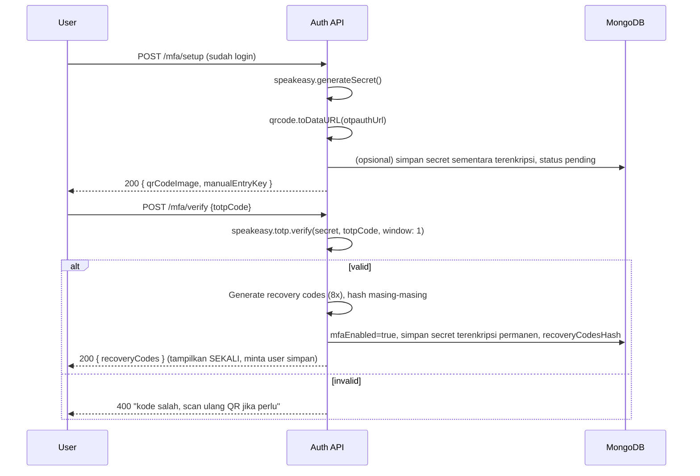

# PRD & Technical Design — MERN Authentication System

**Tipe dokumen:** Product Requirement Document + System Design
**Tujuan:** Portfolio project untuk junior Backend Engineer (target: internship)
**Stack:** Node.js, Express 5, MongoDB (Mongoose), Redis (ioredis), Passport.js, JWT

---

## 1. Overview & Tujuan Project

Membangun **authentication service** yang production-grade secara arsitektur (bukan sekadar tutorial-level), untuk dipakai sebagai:

1. Portfolio yang menunjukkan pemahaman security fundamentals (bukan cuma "bisa bikin login").
2. Reusable auth service yang bisa dipasang di project lain (mis. NusaChain) sebagai standalone auth microservice.
3. Bukti kemampuan system design saat interview — setiap keputusan desain di dokumen ini punya alasan security/scalability yang bisa dijelaskan.

### 1.1 Target Pengguna Sistem
- **End user** — daftar/login untuk mengakses aplikasi client.
- **Developer lain / frontend** — mengonsumsi REST API ini via dokumentasi Swagger.
- **Reviewer/interviewer** — membaca kode & dokumentasi ini untuk menilai kemampuan.

### 1.2 Non-Goals (Out of Scope)
- Tidak membangun frontend (dokumen ini backend-only, sesuai spesifikasi yang diberikan).
- Tidak membangun payment/billing.
- Discord & Twitter OAuth tidak diimplementasikan di fase awal meski dependency-nya sudah terpasang — didesain agar **mudah ditambahkan** karena mengikuti strategy pattern Passport (lihat §6).

---

## 2. Functional Requirements (Fitur)

| # | Fitur | Prioritas |
|---|---|---|
| F1 | Register & Login lokal (email + password) | Must |
| F2 | Verifikasi akun via OTP email (setelah register lokal) | Must |
| F3 | Login/Register via OAuth (Google, GitHub) | Must |
| F4 | Reset password via email | Must |
| F5 | JWT session: access token, refresh token, blacklist mechanism | Must |
| F6 | MFA (TOTP — Google Authenticator style) | Must |
| F7 | Cloudflare Tunnel untuk expose dev server (OAuth callback testing) | Must |
| F8 | Redis caching (OTP, blacklist, rate-limit store) | Must |
| F9 | Rate limiting per-endpoint | Must |
| F10 | Proteksi serangan umum (XSS, NoSQL injection, dll) | Must |
| F11 | Winston logging (request log + error log + security event log) | Must |
| F12 | Global response & error handler | Must |
| F13 | Profile settings (avatar, nama) | Must |

## 3. Non-Functional Requirements

- **Security-first**: setiap keputusan desain harus punya justifikasi security (dijelaskan di tiap bagian).
- **Stateless-friendly**: access token stateless (JWT murni), state minimal hanya untuk refresh token & blacklist (di Redis/Mongo), supaya API mudah di-scale horizontal.
- **Observability**: semua request & error harus tercatat terstruktur (JSON log) agar bisa didemokan saat interview ("bagaimana kamu debug production issue?").
- **Fail-safe default**: kalau Redis down, sistem harus punya fallback yang jelas (didefinisikan per fitur, bukan silent fail).
- **Testable**: setiap service (auth, token, mfa, otp) dipisah dari controller supaya bisa di-unit test tanpa HTTP layer.

---

## 4. Desain Database (MongoDB / Mongoose)

### 4.1 Ringkasan Collection



> **Catatan:** OTP (verifikasi email & reset password) **tidak** disimpan di MongoDB — disimpan di **Redis** dengan TTL native. Alasan: OTP bersifat short-lived (5–10 menit) dan write-heavy (setiap resend = write baru), sehingga Redis jauh lebih cocok daripada Mongo + TTL index (TTL index Mongo hanya dibersihkan tiap ~60 detik, kurang presisi untuk kebutuhan expiry ketat).

### 4.2 Schema `User`

| Field | Tipe | Keterangan |
|---|---|---|
| `name` | String | Nama tampilan |
| `email` | String, unique, lowercase, indexed | Identitas utama |
| `password` | String, `select: false` | Hash bcrypt. `null` jika user murni daftar via OAuth |
| `avatarUrl` | String | URL Cloudinary |
| `avatarPublicId` | String | `public_id` Cloudinary (dibutuhkan untuk delete/replace) |
| `isVerified` | Boolean, default `false` | `true` otomatis untuk user OAuth (email sudah diverifikasi oleh provider) |
| `mfaEnabled` | Boolean, default `false` | |
| `mfaSecretEncrypted` | String, `select: false` | Secret TOTP **dienkripsi** (AES-256-GCM) sebelum disimpan — **jangan pernah simpan secret MFA plaintext**, ini berbeda dari password (yang di-hash, bukan dienkripsi, karena secret MFA perlu didekripsi kembali untuk verifikasi) |
| `recoveryCodesHash` | [String], `select: false` | Hash (bcrypt/SHA-256) dari recovery code MFA — backup kalau user kehilangan device authenticator |
| `authProviders` | [{ provider, providerId, connectedAt }] | Mendukung **account linking**: satu email bisa punya local + google + github sekaligus |
| `role` | String enum `user\|admin`, default `user` | Opsional untuk fase awal, tapi disiapkan agar mudah extend ke role-based access control |
| `status` | String enum `active\|suspended\|deleted`, default `active` | Soft-restriction tanpa hapus data |
| `lastLoginAt`, `lastLoginIp` | Date, String | Untuk audit & anomaly detection sederhana |
| `timestamps` | — | `createdAt`, `updatedAt` otomatis |

**Kenapa `password` dan `mfaSecretEncrypted` pakai `select: false`?**
Supaya query `User.find()` biasa **tidak pernah** ikut menarik data sensitif secara tidak sengaja. Kamu harus eksplisit `.select('+password')` hanya di service login. Ini best practice yang sering jadi pertanyaan saat code review/interview.

### 4.3 Schema `RefreshToken`

Ini bagian paling krusial untuk keamanan sesi. Desainnya pakai pola **rotation + family tracking**, bukan sekadar simpan token mentah.

| Field | Tipe | Keterangan |
|---|---|---|
| `userId` | ObjectId, ref `User`, indexed | |
| `jti` | String, unique | JWT ID — identitas unik tiap token refresh yang diterbitkan |
| `familyId` | String, indexed | UUID yang **sama** untuk seluruh rantai rotasi dari satu login awal. Dipakai untuk revoke masal saat terdeteksi reuse attack |
| `tokenHash` | String | **SHA-256 hash** dari refresh token, bukan token mentah — kalau DB bocor, attacker tidak bisa pakai token langsung |
| `userAgent`, `ip` | String | Metadata device, ditampilkan di halaman "active sessions" (fitur lanjutan opsional) |
| `issuedAt`, `expiresAt` | Date | `expiresAt` diberi TTL index Mongo untuk auto-cleanup |
| `revokedAt` | Date, nullable | Diisi saat logout / reuse detection / reset password |
| `replacedByJti` | String, nullable | Menyambung ke token pengganti hasil rotasi — membentuk rantai audit |

**Kenapa tidak simpan refresh token mentah di DB?** Sama seperti password — DB adalah aset yang bisa bocor (SQL/NoSQL injection, backup leak, insider). Dengan hash, refresh token yang bocor dari DB saja **tidak berguna** tanpa token asli yang dipegang client.

**Kenapa perlu `familyId`?** Ini yang membedakan desain "junior" vs "production-grade". Skenario:
1. User login → dapat refresh token `A` (family `F1`).
2. `A` dipakai untuk refresh → server terbitkan `B`, revoke `A`, `replacedByJti(A) = B`.
3. Kalau ada request refresh **memakai `A` lagi** (token yang sudah revoked) → ini sinyal kuat token dicuri (attacker replay token lama). Server langsung **revoke seluruh family `F1`** (termasuk `B` yang sedang dipakai user asli), memaksa re-login. Ini disebut *refresh token reuse detection*.

### 4.4 Schema `LoginHistory` (opsional, nice-to-have untuk portfolio)

| Field | Tipe |
|---|---|
| `userId` | ObjectId |
| `event` | enum: `LOGIN_SUCCESS`, `LOGIN_FAILED`, `LOGOUT`, `PASSWORD_RESET`, `MFA_ENABLED`, `TOKEN_REUSE_DETECTED` |
| `ip`, `userAgent` | String |
| `createdAt` | Date |

Berguna untuk demo "security dashboard" sederhana saat interview, dan sebagai sumber data anomaly detection dasar (mis. banyak `LOGIN_FAILED` beruntun dari IP sama → trigger captcha/lockout).

### 4.5 Struktur Data di Redis

| Key pattern | Value | TTL | Tujuan |
|---|---|---|---|
| `otp:verify:{userId}` | hash(OTP) + attempts | 5–10 menit | OTP verifikasi email register |
| `otp:reset:{userId}` | hash(OTP/token) + attempts | 10–15 menit | OTP/token reset password |
| `blacklist:at:{jti}` | `"1"` | = sisa umur access token | Blacklist access token saat logout/force-revoke |
| `ratelimit:{ip}:{route}` | counter | sesuai window | Rate limiting |
| `mfa:pending:{userId}` | secret sementara | 5 menit | Secret MFA sebelum diverifikasi & diaktifkan |
| `lockout:{email}` | failed attempt count | 15 menit | Lockout sementara setelah percobaan login gagal beruntun |

---

## 5. Arsitektur Sistem (High Level)



**Kenapa Cloudflare Tunnel?** Google & GitHub OAuth mengharuskan *callback URL* yang terdaftar & bisa diakses publik (bukan `localhost`). Tunnel memberi URL HTTPS publik sementara (`https://xxxx.trycloudflare.com`) yang diarahkan ke server lokal, jadi kamu bisa test OAuth flow end-to-end tanpa deploy dulu.

Setup singkat:
```bash
# install
brew install cloudflared   # atau download binary sesuai OS

# jalankan tunnel ke server lokal
cloudflared tunnel --url http://localhost:5000
```
Lalu daftarkan URL yang muncul (`https://xxxx.trycloudflare.com/api/auth/google/callback`) di Google/GitHub OAuth console, dan set sebagai `OAUTH_CALLBACK_BASE_URL` di `.env`. Untuk domain tetap (bukan random subdomain), bisa pakai *named tunnel* dengan akun Cloudflare (opsional, cocok kalau mau demo publik yang stabil).

---

## 6. Middleware Stack (urutan penting!)

Urutan middleware di Express **memengaruhi keamanan**, bukan cuma soal style:

```
1. helmet()                        → set security headers duluan, sebelum apa pun
2. cors({ origin, credentials })   → whitelist origin, izinkan cookie cross-origin
3. express.json({ limit })         → parse body, batasi ukuran (cegah payload bomb)
4. cookie-parser()
5. mongoSanitize()                 → strip operator NoSQL ($gt, $ne, dll) dari req.body/query/params
6. xss-clean / custom xss sanitizer → strip HTML/script dari input string
7. morgan → winston stream         → request logging
8. Rate limiter (global, longgar)  → proteksi dasar semua endpoint
9. Rate limiter khusus (auth routes, lebih ketat)
10. Routes
11. 404 handler
12. Global error handler           → PALING TERAKHIR
```

> **Catatan security penting:** `express-mongo-sanitize` versi terbaru **tidak kompatibel langsung** dengan Express 5 karena cara Express 5 membuat `req.query` read-only berubah. Perlu dicek versi kompatibel atau terapkan sanitasi manual di layer validator (`express-validator` custom sanitizer) sebagai fallback. Ini poin bagus untuk ditulis di README sebagai bukti kamu paham detail, bukan asal `npm install`.

---

## 7. API Endpoints

| Method | Endpoint | Auth? | Deskripsi |
|---|---|---|---|
| POST | `/api/auth/register` | – | Register lokal |
| POST | `/api/auth/verify-otp` | – | Verifikasi OTP email |
| POST | `/api/auth/resend-otp` | – | Kirim ulang OTP (rate-limited ketat) |
| POST | `/api/auth/login` | – | Login lokal |
| POST | `/api/auth/mfa/validate` | tempToken | Step 2 login jika MFA aktif |
| GET | `/api/auth/google` | – | Redirect ke Google |
| GET | `/api/auth/google/callback` | – | Callback Google |
| GET | `/api/auth/github` | – | Redirect ke GitHub |
| GET | `/api/auth/github/callback` | – | Callback GitHub |
| POST | `/api/auth/refresh-token` | cookie | Rotasi access+refresh token |
| POST | `/api/auth/logout` | Bearer | Logout device saat ini |
| POST | `/api/auth/logout-all` | Bearer | Revoke semua sesi/device |
| POST | `/api/auth/forgot-password` | – | Request reset password |
| POST | `/api/auth/reset-password` | – | Submit password baru |
| POST | `/api/mfa/setup` | Bearer | Generate secret + QR |
| POST | `/api/mfa/verify` | Bearer | Aktivasi MFA |
| POST | `/api/mfa/disable` | Bearer | Nonaktifkan MFA |
| GET | `/api/users/me` | Bearer | Data profil sendiri |
| PATCH | `/api/users/me` | Bearer | Update nama, dll |
| POST | `/api/users/me/avatar` | Bearer | Upload avatar (Cloudinary) |
| PATCH | `/api/users/me/password` | Bearer | Ganti password (saat sudah login) |

---

## 8. Workflow Detail per Fitur

### 8.1 Register Lokal + Verifikasi OTP Email



**Poin security:**
- OTP disimpan **hash**, bukan plaintext — kalau Redis bocor, OTP tidak langsung terbaca.
- Batasi jumlah percobaan verifikasi (mis. 5x) supaya OTP 6-digit tidak bisa di-brute-force (1 juta kombinasi bukan angka aman tanpa rate limit).
- `resend-otp` wajib rate-limited ketat (mis. 1x per 60 detik) untuk cegah email bombing.

### 8.2 Login Lokal (+ percabangan MFA)



**Kenapa pesan error login digeneralisasi ("email atau password salah")?** Supaya endpoint tidak bisa dipakai untuk **user enumeration** — attacker tidak boleh bisa membedakan "email tidak terdaftar" vs "password salah".

### 8.3 Login/Register via OAuth (Google & GitHub)



**Poin desain penting — Account Linking:** kalau user sebelumnya daftar via email/password lalu login pakai Google dengan **email yang sama**, sistem menautkan provider baru ke akun yang sudah ada (bukan bikin akun duplikat). Ini yang dicek reviewer saat menilai pemahaman OAuth kamu — banyak tutorial junior **melewatkan kasus ini** dan malah membuat duplicate user per provider.

### 8.4 Forgot / Reset Password



**Kenapa response `forgot-password` selalu sama** baik email terdaftar atau tidak? Sama seperti login — mencegah user enumeration. **Kenapa revoke semua refresh token setelah reset password?** Kalau alasan reset adalah akun dicuri, sesi lama (termasuk yang dipegang attacker) harus langsung mati.

### 8.5 JWT Session — Access Token, Refresh Token, Blacklist

Ini bagian inti dari spesifikasi kamu. Dipecah jadi 3 sub-alur:

#### a) Issue token saat login/register berhasil

- **Access Token**: JWT, umur pendek (**15 menit**), payload minimal (`sub`, `role`, `jti`), ditandatangani dengan secret **terpisah** dari refresh token.
- **Refresh Token**: JWT atau opaque random string, umur panjang (**7–30 hari**), dikirim via **cookie `HttpOnly` + `Secure` + `SameSite=Strict/Lax`** (jangan pernah taruh refresh token di localStorage — itu rentan XSS). Setiap penerbitan dicatat di collection `RefreshToken` (`jti`, `familyId` baru saat login pertama kali, `tokenHash`).

#### b) Refresh — rotasi + reuse detection



#### c) Blacklist Access Token (saat logout / force-revoke)

Access token JWT **tidak bisa "dicabut"** secara native (statis sampai expired) — makanya butuh blacklist eksplisit di Redis:



Lalu **setiap request ke protected route** wajib melalui middleware `authenticate` yang:
1. Verify signature JWT access token.
2. Cek `Redis.exists('blacklist:at:' + jti)` → kalau ada, tolak meski signature valid.
3. Baru lanjut ke handler.

> Trik efisiensi: TTL key blacklist di Redis = **sisa umur token**, bukan durasi tetap. Jadi Redis otomatis membersihkan entry begitu token itu memang sudah expired secara alami — tidak ada sampah data menumpuk.

**Ringkasan perbedaan mekanisme (poin penting untuk dijelaskan saat interview):**

| | Access Token | Refresh Token |
|---|---|---|
| Umur | Pendek (15 menit) | Panjang (7–30 hari) |
| Disimpan client | Memory/response body (bukan localStorage) | Cookie `HttpOnly` |
| Mekanisme "cabut" | Blacklist di Redis (per-jti, TTL = sisa umur) | Revoke record di Mongo + rotation + family revoke saat reuse |
| Kenapa beda mekanisme | Access token stateless & short-lived → blacklist cukup murah (data kecil, auto-expire cepat) | Refresh token butuh audit trail & reuse detection karena umurnya lama & dampak pencurian lebih besar |

### 8.6 MFA (TOTP)



**Kenapa perlu recovery codes?** Kalau device authenticator user hilang, tanpa recovery code dia **terkunci permanen** dari akunnya sendiri. Ini fitur kecil yang sering dilewatkan tapi langsung terlihat "matang" di mata reviewer.

**Kenapa secret MFA di-*enkripsi*, bukan di-*hash* seperti password?** Karena server perlu **membaca kembali** secretnya tiap kali user login untuk generate/verifikasi kode TOTP — hash bersifat satu arah dan tidak bisa dibalik, sedangkan enkripsi (AES-256-GCM dengan key dari `.env`, terpisah dari JWT secret) bisa didekripsi saat dibutuhkan.

### 8.7 Profile Settings (Avatar & Nama)

- `PATCH /users/me` — update `name` (validasi panjang & sanitasi, tolak field lain seperti `email`/`role` meski dikirim di body — **mass assignment protection**, whitelist field yang boleh diubah).
- `POST /users/me/avatar` — terima file (multer, in-memory buffer, batasi ukuran & tipe file di level middleware sebelum sampai ke Cloudinary) → upload ke Cloudinary → simpan `avatarUrl` + `avatarPublicId` → **hapus avatar lama di Cloudinary** (pakai `avatarPublicId` lama) supaya tidak menumpuk storage sampah.

---

## 9. Rate Limiting Strategy

| Endpoint | Window | Limit | Alasan |
|---|---|---|---|
| Global (semua route) | 15 menit | 300 req/IP | Baseline protection |
| `/auth/login` | 15 menit | 10 req/IP | Cegah brute force password |
| `/auth/register` | 1 jam | 5 req/IP | Cegah spam akun |
| `/auth/verify-otp` | 10 menit | 5 req/user | Cegah brute force OTP 6-digit |
| `/auth/resend-otp` | 1 menit | 1 req/user | Cegah email bombing |
| `/auth/forgot-password` | 15 menit | 3 req/IP+email | Cegah email bombing & enumeration probing |
| `/auth/refresh-token` | 15 menit | 30 req/user | Longgar (dipakai otomatis oleh client) tapi tetap dibatasi |

Untuk fase awal (single instance), in-memory store dari `express-rate-limit` cukup. Kalau nanti deploy multi-instance, tambahkan store Redis (`rate-limit-redis`) supaya counter konsisten antar instance — worth disebut di README sebagai "known limitation & scaling plan" saat interview.

---

## 10. Security Checklist (Security Audit Pass)

- [ ] `helmet()` aktif dengan CSP disesuaikan (bukan default kosong).
- [ ] `cors()` whitelist origin eksplisit, `credentials: true` hanya untuk origin yang dipercaya.
- [ ] Refresh token **hanya** di cookie `HttpOnly + Secure + SameSite`. Access token **tidak pernah** di localStorage.
- [ ] Password: bcrypt cost factor ≥ 12.
- [ ] Semua pesan error auth (login, forgot-password) **generik**, tidak membocorkan apakah email terdaftar.
- [ ] OTP & reset token disimpan sebagai **hash**, punya batas percobaan, dan TTL pendek.
- [ ] Refresh token disimpan sebagai **SHA-256 hash**, bukan plaintext.
- [ ] Reuse detection aktif → revoke seluruh token family saat terdeteksi.
- [ ] MFA secret **dienkripsi** (bukan plaintext, bukan hash) dengan key terpisah dari JWT secret.
- [ ] Recovery codes MFA di-hash, hanya ditampilkan sekali.
- [ ] `express-mongo-sanitize` + validator untuk cegah NoSQL injection (`$where`, `$gt`, dll).
- [ ] Sanitasi XSS di semua input string sebelum disimpan/ditampilkan.
- [ ] Mass assignment protection — endpoint update profile pakai whitelist field, bukan `Object.assign(user, req.body)` mentah.
- [ ] Rate limiting berbeda ketat per jenis endpoint (lihat §9).
- [ ] JWT: algoritma eksplisit di-set (`HS256`), secret access & refresh **berbeda**, tidak pernah trust `alg` dari token header tanpa verifikasi eksplisit.
- [ ] Swagger UI **tidak** ter-expose di production (atau minimal diberi basic auth).
- [ ] Log **tidak pernah** mencatat password, token mentah, atau secret MFA — hanya event & metadata.
- [ ] Validasi environment variable wajib ada saat boot (app harus gagal start kalau `.env` penting hilang, bukan jalan dengan `undefined` secret).

---

## 11. Logging (Winston) & Global Error Handler

### 11.1 Strategi Logging

- **HTTP request log**: `morgan` → stream ke `winston` (format kombinasi, bukan `dev` di production).
- **Level log**: `error` (exception tak tertangani, error 5xx), `warn` (error operasional 4xx, mis. login gagal), `info` (event penting: login sukses, register, MFA enabled), `debug` (development only).
- **winston-daily-rotate-file**: rotasi harian, retensi mis. 14 hari, pisahkan file `error-%DATE%.log` dan `combined-%DATE%.log`.
- **Security event log** terpisah (opsional tapi bagus untuk portfolio): `TOKEN_REUSE_DETECTED`, `MFA_ENABLED`, `MULTIPLE_LOGIN_FAILED` — memudahkan demo "bagaimana saya memonitor aktivitas mencurigakan".

### 11.2 Pola Global Response & Error Handler

**Format response konsisten:**
```json
// Sukses
{ "success": true, "message": "Login berhasil", "data": { "accessToken": "..." } }

// Error
{ "success": false, "message": "Email atau password salah", "error": { "code": "AUTH_INVALID_CREDENTIALS" } }
```

**Pola implementasi:**
1. `ApiError` class (extends `Error`) — punya `statusCode`, `code`, `isOperational`.
2. `ApiResponse` helper — bikin bentuk response sukses konsisten.
3. `catchAsync(fn)` wrapper — bungkus semua controller async, supaya tidak perlu `try/catch` berulang, otomatis `next(err)` kalau reject.
4. Middleware error handler **paling akhir** di `app.js`:
   - Kalau `err.isOperational` (mis. `ApiError` yang sengaja dilempar) → response sesuai `statusCode`, log level `warn`.
   - Kalau bukan (bug tak terduga) → response generik `500 "terjadi kesalahan pada server"` (jangan bocorkan stack trace ke client), log level `error` dengan full stack ke Winston.
5. 404 handler diletakkan **sebelum** error handler tapi **setelah** semua route, untuk menangkap route yang tidak match.

---

## 12. Folder Structure

```
src/
├── config/
│   ├── db.js              # koneksi Mongoose
│   ├── redis.js            # koneksi ioredis
│   ├── passport.js         # strategy local, jwt, google, github
│   ├── cloudinary.js
│   ├── swagger.js
│   └── env.js               # validasi & export env vars
├── models/
│   ├── user.model.js
│   └── refreshToken.model.js
├── controllers/
│   ├── auth.controller.js
│   ├── mfa.controller.js
│   └── user.controller.js
├── services/
│   ├── auth.service.js
│   ├── token.service.js     # sign/verify/rotate/blacklist
│   ├── otp.service.js
│   ├── mfa.service.js
│   ├── email.service.js
│   └── upload.service.js    # cloudinary
├── middlewares/
│   ├── authenticate.js      # verify JWT + cek blacklist
│   ├── rateLimiter.js
│   ├── security.js          # helmet/cors/sanitize config
│   ├── validate.js          # wrapper express-validator
│   └── error.middleware.js
├── routes/
│   ├── auth.routes.js
│   ├── mfa.routes.js
│   └── user.routes.js
├── validators/
│   └── auth.validator.js
├── utils/
│   ├── ApiError.js
│   ├── ApiResponse.js
│   ├── catchAsync.js
│   ├── logger.js
│   └── crypto.js             # helper hash/encrypt untuk MFA secret & refresh token
├── jobs/
│   └── cleanupExpiredTokens.js  # opsional, cron cleanup RefreshToken lama
├── app.js
└── index.js
```

---

## 13. Environment Variables

```env
NODE_ENV=development
PORT=5000

MONGO_URI=
REDIS_URL=

JWT_ACCESS_SECRET=
JWT_REFRESH_SECRET=
JWT_ACCESS_EXPIRES=15m
JWT_REFRESH_EXPIRES=7d

MFA_ENCRYPTION_KEY=          # 32-byte key untuk AES-256-GCM

GOOGLE_CLIENT_ID=
GOOGLE_CLIENT_SECRET=
GITHUB_CLIENT_ID=
GITHUB_CLIENT_SECRET=
OAUTH_CALLBACK_BASE_URL=     # diisi URL Cloudflare Tunnel saat dev

SMTP_HOST=
SMTP_PORT=
SMTP_USER=
SMTP_PASS=

CLOUDINARY_CLOUD_NAME=
CLOUDINARY_API_KEY=
CLOUDINARY_API_SECRET=

CORS_ORIGIN=http://localhost:5173
COOKIE_DOMAIN=
```

---

## 14. Roadmap Pembangunan (Bertahap)

Supaya tidak overwhelmed, bangun berurutan — tiap tahap bisa langsung di-commit & dites terpisah:

1. **Foundation**: setup Express + config (db, redis, logger, error handler, response helper) — belum ada fitur, tapi skeleton sudah solid.
2. **Auth lokal dasar**: register → login → JWT access+refresh sederhana (belum rotation) → protected route.
3. **Refresh token proper**: tambahkan `jti`, `familyId`, rotation, reuse detection, blacklist logout.
4. **Email OTP verification** + **forgot/reset password**.
5. **OAuth Google & GitHub** (+ account linking).
6. **MFA (TOTP)** + recovery codes.
7. **Security hardening**: rate limiter per-route, sanitasi, helmet/cors tuning.
8. **Profile settings**: avatar (Cloudinary) + update nama.
9. **Polish**: Swagger docs, README dengan diagram dari dokumen ini, unit test untuk service layer (token rotation & MFA logic paling penting untuk ditest).

**Tips untuk portfolio/interview:** simpan dokumen ini (atau versi ringkasnya) sebagai `ARCHITECTURE.md` di repo. Interviewer backend/security jauh lebih tertarik pada *alasan* di balik desain refresh token rotation & blacklist dibanding sekadar melihat kode yang jalan.
